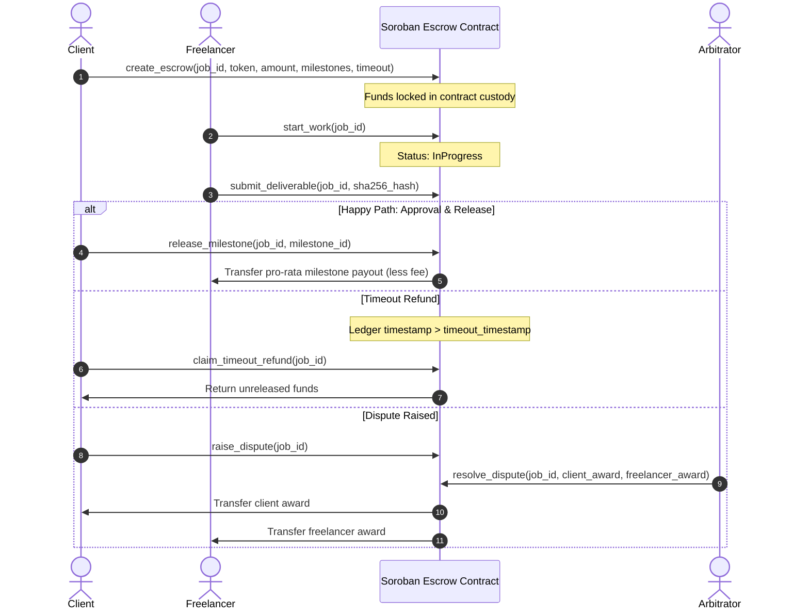

# 🛡️ Soroban Escrow SDK

> **Type-safe TypeScript SDK and audit-grade Soroban smart contract for non-custodial milestone escrow, automated timeouts, and multi-token settlements on Stellar.**
>
> *Built for developers, marketplaces, and freelance platforms building trustless commerce on Stellar.*

---

[](https://github.com/Stellar-PurplePay/soroban-escrow-sdk/actions/workflows/ci.yml)
[](LICENSE)
[](https://stellar.org)
[](https://www.typescriptlang.org)
[](https://www.rust-lang.org)
[](CONTRIBUTING.md)

---

## 🌐 Deployed Smart Contract (Stellar Testnet)

| Component | Target / Environment | Live URL / Explorer Link |
| :--- | :--- | :--- |
| **Soroban Smart Contract** | Stellar Testnet | [`CA5DEQZ64FKZL7KVWOEKXWJVZJXP4JKEQUAO7GFNYZYQRKI6N5CWEDU3`](https://stellar.expert/explorer/testnet/contract/CA5DEQZ64FKZL7KVWOEKXWJVZJXP4JKEQUAO7GFNYZYQRKI6N5CWEDU3) |
| **Stellar Lab Contract** | Stellar Testnet | [View in Stellar Lab](https://lab.stellar.org/r/testnet/contract/CA5DEQZ64FKZL7KVWOEKXWJVZJXP4JKEQUAO7GFNYZYQRKI6N5CWEDU3) |
| **Deploy Transaction** | Stellar Testnet | [`de6c87db7102...`](https://stellar.expert/explorer/testnet/tx/de6c87db71027b429999719f6e0521c84fc8101c8b51e866d1f4c86acc60fff9) |
| **Init Transaction** | Stellar Testnet | [`0b563fe9acf5...`](https://stellar.expert/explorer/testnet/tx/0b563fe9acf5e6cf068190f777f725ddd236efda34dc4369b64b14c4372c57b3) |
| **Admin / Treasury Key** | Stellar Testnet | `GBWFZHBYEKF5MR2MHW7JAZX6ZRI2PKKBL6IALEMJSBMU4JMDSIB34KP5` |
| **Platform Fee** | Basis Points | `100 bps` (1.00%) |


## 🌟 Key Features

- 🔒 **Non-Custodial Escrow**: Funds are locked strictly inside the Soroban contract until explicit milestone release, mutual resolution, or permissionless timeout.
- 🎯 **Pro-Rata Milestone Payouts**: Define percentage-based milestones (e.g. 30% / 30% / 40%). Approving a milestone transfers the exact allocated portion while keeping the rest safely locked.
- ⏱️ **Permissionless Timeout Refunds**: If work is never commenced or deliverable milestones lapse past the predetermined deadline, anyone can invoke the timeout trigger to refund remaining funds directly back to the client.
- 🪙 **Multi-Token Support (SEP-41)**: Natively compatible with Stellar Lumens (XLM), fiat-backed stablecoins (USDC), and any SEP-41 compliant asset.
- ⚖️ **Dispute Arbitration Hook**: Designate a trusted arbitrator address (or DAO contract) with authorization to resolve disputes and allocate funds.
- 📦 **End-to-End TypeScript SDK**: Type-safe client library handling argument encoding, parameter validation, deliverable hash verification, and atomic conversions.

---

## 🏗️ Architecture & Escrow Lifecycle



---

## 📁 Repository Structure

```text
soroban-escrow-sdk/
├── contracts/
│   └── escrow/                     # Rust Soroban smart contract
│       ├── Cargo.toml              # soroban-sdk 27+ dependencies
│       └── src/
│           ├── lib.rs              # Contract entrypoint & implementation
│           ├── types.rs            # Contract data types & storage keys
│           ├── errors.rs           # Typed Soroban contract errors
│           └── test.rs             # Full unit test suite (5 test cases)
├── packages/
│   └── sdk/                        # TypeScript client SDK
│       ├── package.json            # @stellar-purplepay/escrow-sdk
│       ├── tsconfig.json
│       ├── src/
│       │   ├── client.ts           # EscrowClient implementation
│       │   ├── types.ts            # TypeScript interfaces
│       │   ├── utils.ts            # Atomic unit & address validators
│       │   └── errors.ts           # Custom SDK errors
│       └── test/                   # Jest unit tests (11 test cases)
├── examples/
│   └── quickstart.ts               # End-to-end integration walkthrough
├── .github/
│   └── workflows/ci.yml            # Automated CI for Rust & TypeScript
├── CONTRIBUTING.md                 # Developer setup and PR standards
├── ROADMAP.md                      # Drips Wave sprint backlog & issue points
└── LICENSE                         # MIT License
```

---

## ⚡ Quick Start

### 1. Smart Contract Development (Rust)

#### Prerequisites
- Rust `>= 1.74`
- Soroban SDK `27.0.6`

```bash
cd contracts/escrow

# Run unit tests
cargo test

# Build optimized WASM artifact
cargo build --target wasm32v1-none --release
```

---

### 2. TypeScript SDK Usage

#### Installation
```bash
npm install @stellar-purplepay/escrow-sdk @stellar/stellar-sdk
```

#### Basic Usage Example
```typescript
import { EscrowClient, toAtomicUnits } from "@stellar-purplepay/escrow-sdk";

const client = new EscrowClient({
  rpcUrl: "https://soroban-testnet.stellar.org",
  networkPassphrase: "Test SDF Network ; September 2015",
  contractId: "CA5DEQZ64FKZL7KVWOEKXWJVZJXP4JKEQUAO7GFNYZYQRKI6N5CWEDU3",
});

// 1. Prepare escrow with pro-rata milestones
const createPayload = client.prepareCreateEscrow({
  jobId: "audit-task-001",
  client: "GAAZI4TCR3TY5OJHCTJC2A4QSY6CJWJH5IAJTGKIN2ER7LBNVKOCCWN7",
  freelancer: "GBBD47IF6LWK7P7MDEVSCWR7DPUWV3NY3DTQEVFL4NAT4AQH3ZLLFLA5",
  tokenAddress: "CDLZFC3SYJYDZT7K67VZ75HPJVIEUVNIXF47ZG2FB2RMQQVU2HHGCYSC", // USDC contract
  amount: toAtomicUnits("1000", 7), // 1,000 USDC
  timeoutTimestamp: Math.floor(Date.now() / 1000) + 14 * 86400, // 14 days
  arbitratorAddress: "GCKCWVE4EZP4SGF4YQ24WTYUGU6F4KDTQELFTX2NYW7K2G6KFFTY4VLL",
  milestones: [
    { description: "Milestone 1: Preliminary Analysis", percentage: 40 },
    { description: "Milestone 2: Final Report Delivery", percentage: 60 },
  ],
});

// 2. Submit deliverable cryptographic proof (SHA-256)
const deliverablePayload = client.prepareSubmitDeliverable(
  "audit-task-001",
  "GBBD47IF6LWK7P7MDEVSCWR7DPUWV3NY3DTQEVFL4NAT4AQH3ZLLFLA5",
  "e3b0c44298fc1c149afbf4c8996fb92427ae41e4649b934ca495991b7852b855"
);

// 3. Client approves Milestone 1
const releasePayload = client.prepareReleaseMilestone(
  "audit-task-001",
  "GAAZI4TCR3TY5OJHCTJC2A4QSY6CJWJH5IAJTGKIN2ER7LBNVKOCCWN7",
  1
);
```

---

## 🧪 Comprehensive Testing

### Smart Contract Tests
```bash
cd contracts/escrow
cargo test
```
* Coverage:
  * Single milestone creation & instant release
  * Multi-milestone pro-rata arithmetic & fee deductions
  * Cancel and refund before work commences
  * Permissionless timeout refunds after deadline expiration
  * Dispute resolution & arbitrator fund allocation

### SDK Tests
```bash
cd packages/sdk
npm test
```
* Coverage:
  * Address format validation
  * Atomic unit conversions (7 decimals for XLM/USDC)
  * Milestone percentage summation validation (strictly 100%)
  * Future timeout timestamp assertion
  * Deliverable hash 32-byte hex validation

---

## 🌊 Drips Wave Contributor Backlog

We actively participate in **Stellar Drips Wave** monthly sprint cycles! 

Check [ROADMAP.md](ROADMAP.md) for open contributor tasks categorized by points (**100 / 150 / 200 pts**):
- **#1 [SDK] Add Freighter wallet transaction signing helper** (150 pts)
- **#2 [Contract] Migrate event emission to Soroban `#[contractevent]`** (100 pts)
- **#3 [SDK] Add resource fee and CPU instruction estimator helper** (150 pts)
- **#4 [Contract] Add proptest property-based tests for milestone splits** (200 pts)
- **#5 [SDK] Implement auto-retry with backoff on Soroban RPC 429s** (150 pts)

See [CONTRIBUTING.md](CONTRIBUTING.md) to get started.

---

## 📜 License

Licensed under the [MIT License](LICENSE).
