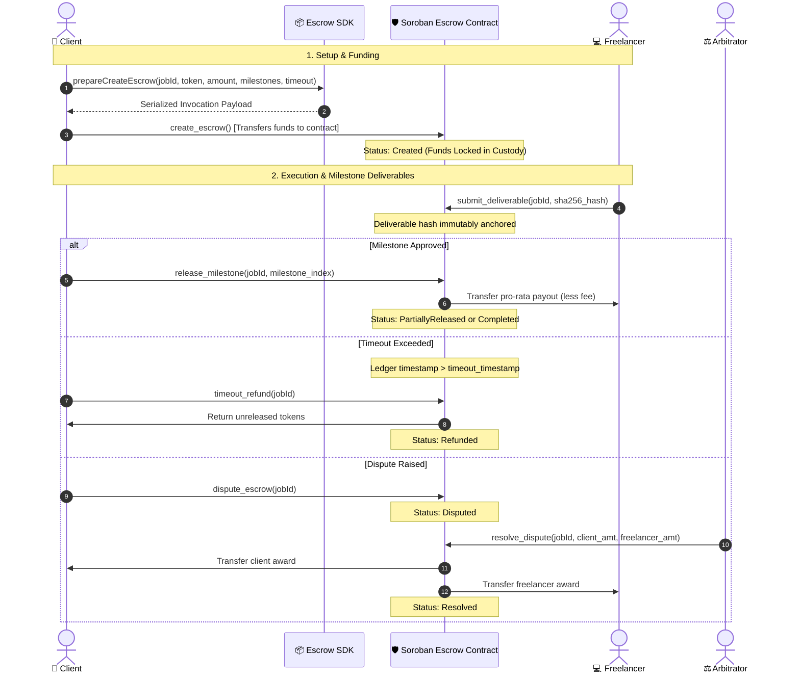

# 🛡️ Soroban Escrow SDK

> **Production-grade Soroban smart contract and type-safe TypeScript SDK for non-custodial milestone escrow, automated timeouts, and multi-token settlements on the Stellar network.**
>
> *Engineered for marketplaces, freelance platforms, and decentralized applications building trustless commerce on Stellar.*

---

[](https://github.com/Stellar-PurplePay/soroban-escrow-sdk/actions/workflows/ci.yml)
[](packages/sdk/package.json)
[](LICENSE)
[](https://stellar.org)
[](https://www.typescriptlang.org)
[](https://www.rust-lang.org)
[](SECURITY.md)
[](CODE_OF_CONDUCT.md)
[](CONTRIBUTING.md)

---

## 🏷️ Repository Tags & Topics

```text
stellar, soroban, escrow, smart-contracts, typescript-sdk, rust, wasm, payments, sep-10, sep-41, milestone-payments, freighter
```

---

## 🌐 Live Deployed Contract (Stellar Testnet)

| Parameter | Value / Network Details | Verification Link |
| :--- | :--- | :--- |
| **Contract ID** | `CA5DEQZ64FKZL7KVWOEKXWJVZJXP4JKEQUAO7GFNYZYQRKI6N5CWEDU3` | [Stellar Expert Explorer](https://stellar.expert/explorer/testnet/contract/CA5DEQZ64FKZL7KVWOEKXWJVZJXP4JKEQUAO7GFNYZYQRKI6N5CWEDU3) |
| **Interactive Console** | Stellar Lab Explorer | [Testnet Stellar Lab](https://lab.stellar.org/r/testnet/contract/CA5DEQZ64FKZL7KVWOEKXWJVZJXP4JKEQUAO7GFNYZYQRKI6N5CWEDU3) |
| **Deploy Transaction** | `de6c87db71027b42...` | [View Deploy Tx](https://stellar.expert/explorer/testnet/tx/de6c87db71027b429999719f6e0521c84fc8101c8b51e866d1f4c86acc60fff9) |
| **Init Transaction** | `0b563fe9acf5e6cf...` | [View Init Tx](https://stellar.expert/explorer/testnet/tx/0b563fe9acf5e6cf068190f777f725ddd236efda34dc4369b64b14c4372c57b3) |
| **Treasury / Admin Key** | `GBWFZHBYEKF5MR2MHW7JAZX6ZRI2PKKBL6IALEMJSBMU4JMDSIB34KP5` | Stellar Account |
| **Network Passphrase** | `Test SDF Network ; September 2015` | Testnet |
| **RPC Endpoint** | `https://soroban-testnet.stellar.org` | SDF Public Node |

---

## 🌟 Key Capabilities & Architectural Guarantees

- 🔒 **100% Non-Custodial Escrow**: Funds are locked exclusively inside the Soroban contract custody balance. Neither the platform admin nor any third party can unilaterally seize funds.
- 🎯 **Pro-Rata Milestone Payouts**: Define granular milestone percentages (e.g. 25% / 25% / 50%). Approving a milestone dispatches its exact allocated portion while keeping remaining milestones safely escrowed.
- 🧮 **Dust-Free Stroop Math**: Integer stroop division calculates exact allocations, automatically assigning rounding remainders to the final milestone so zero tokens remain trapped in custody.
- 🛡️ **On-Chain Fee Protection (PP-11)**: Hard on-chain ceiling constant `MAX_FEE_BPS = 1_000` (10.00% maximum platform fee). Any attempt to exceed 10% reverts with `EscrowError::InvalidFee`.
- 🛑 **Milestone Bounds & DoS Resistance (PP-14)**: Milestones are capped at a maximum of 25 items (`MAX_MILESTONES = 25`), descriptions are bounded to 256 bytes, and percentages are checked for arithmetic overflow.
- 📐 **Zero-Loss Monetary Precision (PP-12)**: TypeScript SDK utility `toAtomicUnits` validates fractional digits against the token's decimal precision, strictly rejecting excess decimal precision, negative numbers, and scientific notation.
- 🔑 **Cryptographic StrKey Validation (PP-13)**: Address inputs are checked via `@stellar/stellar-sdk`'s `StrKey` validators, ensuring base32 validity and CRC16-XModem checksum integrity.
- ⏱️ **Permissionless Timeout Refunds**: If a milestone expires past its deadline, the client can reclaim unreleased funds directly from the contract.
- ⚖️ **Tripartite Dispute Arbitration**: Counterparties can escalate disputes to a designated arbitrator with on-chain authority to split funds.
- 🔐 **SEP-0010 Stellar Web Authentication**: Integrated `Sep10Client` providing end-to-end challenge retrieval, Freighter signing, and JWT session exchange.

---

## 🏗️ Architecture & Escrow Lifecycle



---

## ⚡ Quick Start: Smart Contract (Rust)

### Prerequisites
- Rust `>= 1.74`
- WebAssembly target `wasm32v1-none` (`rustup target add wasm32v1-none`)

### Build & Test
```bash
# Navigate to contract directory
cd contracts/escrow

# Run 47 unit, property, and integration tests
cargo test

# Enforce zero-warning clippy linting
cargo clippy --all-targets -- -D warnings

# Check code formatting
cargo fmt --check

# Compile production-optimized WebAssembly artifact
cargo build --target wasm32v1-none --release
```

Compiled WASM bytecode will be located at:
`contracts/escrow/target/wasm32v1-none/release/soroban_escrow_contract.wasm`

---

## 📦 Quick Start: TypeScript SDK

### Installation
```bash
npm install @stellar-purplepay/escrow-sdk @stellar/stellar-sdk
```

### Complete Code Example: Milestone Escrow Lifecycle
```typescript
import { EscrowClient, toAtomicUnits, fromAtomicUnits } from "@stellar-purplepay/escrow-sdk";

// 1. Initialize the client
const client = new EscrowClient({
  rpcUrl: "https://soroban-testnet.stellar.org",
  networkPassphrase: "Test SDF Network ; September 2015",
  contractId: "CA5DEQZ64FKZL7KVWOEKXWJVZJXP4JKEQUAO7GFNYZYQRKI6N5CWEDU3",
});

// 2. Prepare an escrow creation payload with 2 milestones
const futureTimeout = Math.floor(Date.now() / 1000) + 14 * 86400; // 14 days from now

const createPayload = client.prepareCreateEscrow({
  jobId: "job-website-redesign-2026",
  client: "GAAZI4TCR3TY5OJHCTJC2A4QSY6CJWJH5IAJTGKIN2ER7LBNVKOCCWN7",
  freelancer: "GBBD47IF6LWK7P7MDEVSCWR7DPUWV3NY3DTQEVFL4NAT4AQH3ZLLFLA5",
  tokenAddress: "CDLZFC3SYJYDZT7K67VZ75HPJVIEUVNIXF47ZG2FB2RMQQVU2HHGCYSC", // USDC token contract
  amount: toAtomicUnits("1500", 7), // Exactly 1,500 USDC (in stroops)
  timeoutTimestamp: futureTimeout,
  arbitratorAddress: "GAPTL2OLC4YDSJJ6MGT3MMBWIYD4GSVKQFU26647IOMBEEXUURNUM32X",
  milestones: [
    { description: "Figma UI/UX Mockups", percentage: 40 },
    { description: "Production Next.js Frontend", percentage: 60 },
  ],
});

console.log("Invocation Method:", createPayload.method);
console.log("Contract Arguments:", createPayload.args);

// 3. Prepare milestone release payload
const releasePayload = client.prepareReleaseMilestone({
  jobId: "job-website-redesign-2026",
  client: "GAAZI4TCR3TY5OJHCTJC2A4QSY6CJWJH5IAJTGKIN2ER7LBNVKOCCWN7",
  milestoneIndex: 0,
});

console.log("Release Payload:", releasePayload);
```

### SEP-0010 Web Authentication Client Example
```typescript
import { Sep10Client } from "@stellar-purplepay/escrow-sdk";

const sep10 = new Sep10Client({
  authEndpoint: "https://stellarpurplepay.vercel.app/api/auth/challenge",
  tokenEndpoint: "https://stellarpurplepay.vercel.app/api/auth/token",
  networkPassphrase: "Test SDF Network ; September 2015",
  homeDomain: "stellarpurplepay.vercel.app",
});

// 1. Fetch challenge transaction XDR
const { transactionXdr, networkPassphrase } = await sep10.getChallenge(
  "GAAZI4TCR3TY5OJHCTJC2A4QSY6CJWJH5IAJTGKIN2ER7LBNVKOCCWN7"
);

// 2. Sign with Freighter or hardware wallet (simulated here)
// const signedXdr = await window.freighter.signTransaction(transactionXdr, { networkPassphrase });

// 3. Exchange signed transaction for JWT session token
// const { token } = await sep10.exchangeToken(signedXdr);
```

---

## 🧪 Comprehensive Quality Assurance & Tests

```bash
# 1. Test Rust Contract (47 Unit, Concurrency, and Property Tests)
cd contracts/escrow
cargo test

# 2. Test TypeScript SDK (37 Test Suites / 226 Tests)
cd ../../packages/sdk
npm test

# 3. Compile TypeScript SDK
npm run build
```

---

## 📁 Repository Structure

```text
soroban-escrow-sdk/
├── contracts/
│   └── escrow/                     # Audited Soroban smart contract (Rust)
│       ├── Cargo.toml              # soroban-sdk 27.0.6 dependencies
│       └── src/
│           ├── lib.rs              # Contract entrypoints, state transitions & fee ceiling
│           ├── types.rs            # Data structures, EscrowStatus & storage keys
│           ├── errors.rs           # Typed Soroban contract errors (16–18 added)
│           └── test.rs             # 47 unit & property tests (auth, math, milestones, ceilings)
├── packages/
│   └── sdk/                        # TypeScript client SDK
│       ├── package.json            # @stellar-purplepay/escrow-sdk package definition
│       ├── tsconfig.json           # Strict TypeScript configuration
│       ├── src/
│           ├── client.ts           # EscrowClient implementation
│           ├── sep10Client.ts      # SEP-0010 Stellar Web Authentication client
│           ├── estimator.ts        # Soroban footprint and gas fee estimation
│           ├── types.ts            # Type interfaces and argument DTOs
│           ├── utils.ts            # Precision stroop conversion & StrKey checksum validation
│           └── errors.ts           # ValidationError & ClientError hierarchies
│       └── test/                   # 37 Jest test suites / 226 tests
├── docs/
│   └── SEP10_INTEGRATION_GUIDE.md  # Comprehensive guide for SEP-0010 authentication
├── examples/
│   └── quickstart.ts               # End-to-end integration walkthrough
├── .github/
│   └── workflows/ci.yml            # Automated GitHub Actions CI (Rust, Clippy, Node 18/20 Matrix)
├── CHANGELOG.md                    # Release history and audit remediation log
├── CODE_OF_CONDUCT.md              # Contributor Covenant v2.1
├── CONTRIBUTING.md                 # Development, formatting, and PR guidelines
├── SECURITY.md                     # Vulnerability reporting policy & SLAs
└── LICENSE                         # MIT License
```

---

## 📄 License & Community

Distributed under the **MIT License**. See [LICENSE](LICENSE) for details.  
Built with 💜 by the **Stellar PurplePay** community for the Stellar ecosystem.
